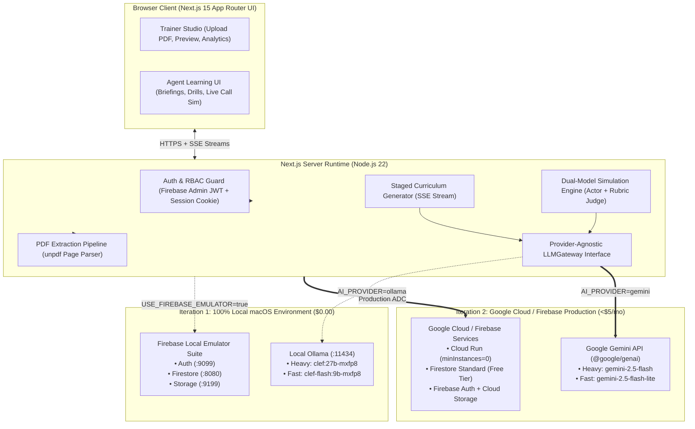

# 02 — System Architecture, Tech Stack & Sub-\$5/Month Cost Model

---

## 1. Architectural Guiding Principles

1. **Zero-Config User Experience, Production-Grade Internals:** Non-technical trainers only ever upload a PDF and click publish; all chunking, schema enforcement, rubric synthesis, and competency tagging happen deterministically on the backend.
2. **Local LLM First (Iteration 1) → Cloud Gemini API Second (Iteration 2):** A strict `LLMGateway` TypeScript interface decouples application workflows from the underlying model runtime. Switching from Connor's local macOS **Ollama** server (`clef:27b-mxfp8` + `clef-flash:9b-mxfp8`) to **Google Gemini 2.5 Flash & Flash-Lite** requires changing a single environment variable (`AI_PROVIDER=gemini`) with zero code rewrites.
3. **100% Google Single-Bill Serverless Topology (< \$5/month at 150+ Users):** No idle virtual machines and no \$15+/month managed SQL instances. Compute runs on **Firebase App Hosting (Google Cloud Run `minInstances: 0`)**, persistence runs on **Cloud Firestore Standard Edition** (using document bundling and atomic rollups to stay inside Google's Always-Free tier), auth runs on **Firebase Authentication**, and PDFs live in **Cloud Storage**.

---

## 2. High-Level Topology: Iteration 1 vs. Iteration 2



---

## 3. Standardized Technology Stack

| Layer | Technology Choice | Why This Choice Fits Both Rapid Swarm Build & <\$5/mo Budget |
| :--- | :--- | :--- |
| **Framework** | **Next.js 15 (App Router, TypeScript 5.x, React 19)** | Single unified TypeScript codebase for SSR UI, Route Handlers (SSE streaming for PDF build & roleplay chat), and Server Actions. Zero cross-repo CORS or deployment complexity. |
| **Styling & UI** | **Tailwind CSS v4 + CSS Custom Properties + Lucide Icons** | Clean custom `"Slate & Signal"` design tokens, native HTML `<dialog>` & Popover APIs, responsive desktop/laptop agent layouts, zero bloated UI framework lock-in. |
| **Authentication** | **Firebase Authentication + `firebase-admin` Session Cookies** | Free up to 50,000 MAUs. Native 1-click **Google Workspace OAuth (`@logicall.io`)** for staff + Email/Password provider backing both external emails and synthetic **`LC`-ID logins** (`LC-1042` → `lc-1042@roster.logicall.internal`). |
| **Database** | **Cloud Firestore (Standard Edition, `(default)` DB)** | 1 GiB storage, 50k reads/day, 20k writes/day **Always Free**. Bundled curriculum version docs + pre-aggregated rollup docs keep 150+ users well inside \$0/month. |
| **File Storage** | **Cloud Storage for Firebase (`gs://...`)** | 5 GB free tier. Stores raw uploaded Campaign Playbook PDFs (~0.2–2 MB each) with signed server upload/download access. |
| **PDF Parsing** | **`unpdf` (Serverless `pdf.js` build for Node.js)** | Pure JavaScript/TypeScript with zero native C++/Python binary dependencies; extracts clean per-page text and structure identically on macOS and Cloud Run containers. |
| **Schema Validation** | **`zod` + `zod-to-json-schema`** | Single source of truth for Firestore documents, API payloads, Ollama `format` JSON schemas, and Gemini `responseSchema` structured outputs. |
| **AI SDKs** | **Native `fetch` for Ollama (`/api/chat`) + `@google/genai` SDK** | Zero LangChain bloat. Direct, deterministic structured JSON calls and token-by-token streaming via a 150-line `LLMGateway` abstraction. |
| **Hosting** | **Firebase App Hosting (Google Cloud Run `minInstances: 0`)** | Scale-to-zero serverless container inside LogiCall's Google account, integrated with Cloud Secret Manager and GitHub automatic deploys. |
| **Testing** | **Vitest (Unit/Integration) + Playwright (E2E)** | Deterministic automated verification gates for multi-agent swarm development against the Firebase Local Emulator and mock/local LLM adapters. |

---

## 4. Detailed Monthly Cost Model (150 Active Trainees)

Why **Cloud SQL was eliminated**: Even an idle `db-f1-micro` Cloud SQL instance costs \$12–\$22/month before a single user logs in. By pairing **scale-to-zero Cloud Run** with **document-bundled Cloud Firestore Standard Edition**, fixed infrastructure cost drops to **\$0.00/month**.

### 4.1 Monthly Usage Assumptions (Generous Workload for 150 Users)
* **Active Users:** 150 agents + 20 trainers/supervisors/admins = **170 MAUs**.
* **New / Updated PDF Playbooks Published:** **25 PDFs / month** (avg. 18 pages / ~12,000 tokens per PDF).
* **Training Volume:** Each of the 150 agents completes **5 full Campaign Tracks / month** (= **750 track completions/mo**, ~3,000 checkpoint completions/mo, and **750 multi-turn Live Call Sim sessions/mo** averaging 8 agent-AI turns + 1 full rubric evaluation each).

### 4.2 Line-by-Line Google Cloud & Gemini API Cost Breakdown

| Service | Projected Monthly Usage (150 Users) | Google Cloud / Firebase Free Tier Included | Billable Overage | Estimated Monthly Cost |
| :--- | :--- | :--- | :--- | :--- |
| **Cloud Run (via Firebase App Hosting)** | ~220,000 HTTP/SSE requests, ~45,000 vCPU-sec (`1 vCPU, 512 MiB, minInstances: 0`) | 2,000,000 requests, 180,000 vCPU-sec, 360,000 GB-sec / mo | 0 | **\$0.00** |
| **Firebase Authentication** | 170 Monthly Active Users (Google OAuth + Email/`LC`-ID) | 50,000 MAUs / mo | 0 | **\$0.00** |
| **Cloud Firestore (Standard)** | ~65,000 doc reads/mo (~2,160/day), ~18,000 doc writes/mo (~600/day), ~80 MB stored | 1,500,000 reads/mo (50k/day), 600,000 writes/mo (20k/day), 1 GiB storage | 0 | **\$0.00** |
| **Cloud Storage (PDFs)** | ~300 PDFs stored (~250 MB total), ~1 GB egress | 5 GB storage, 1 GB/day egress | 0 | **\$0.00** |
| **Cloud Secret Manager** | 2 active secret versions (`GEMINI_API_KEY`, `SESSION_SECRET`), ~500 accesses | 6 active secret versions, 10,000 accesses / mo | 0 | **\$0.00** |
| **Gemini 2.5 Flash** *(PDF Track Generation + Sim Rubric Grading)* | • 25 PDFs × (~25k in + ~12k out tokens)<br>• 750 rubric evals × (~2.5k in + ~700 out tokens)<br>Total: **~2.5M input / ~0.83M output tokens** | Pay-as-you-go (`~\$0.30 / 1M in`, `~\$2.50 / 1M out`) | 2.5M in + 0.83M out | **~\$2.83** |
| **Gemini 2.5 Flash-Lite** *(Live Roleplay Chat Turns)* | 750 sims × 8 turns × (~1.5k in + ~120 out tokens)<br>Total: **~9.0M input / ~0.72M output tokens** | Pay-as-you-go (`~\$0.10 / 1M in`, `~\$0.40 / 1M out`) | 9.0M in + 0.72M out | **~\$1.19** |
| **Cloud Build (Deploys)** | ~10–15 container builds / month (~40 build-minutes) | 120 build-minutes / day (3,600 / mo) | 0 | **\$0.00** |
| **TOTAL MONTHLY RUN COST** | **150 Active Trainees + 25 New PDFs/mo** | | | **~\$4.02 / month** |

> **Cost Guardrail Built In:** Add a Google Cloud Billing Budget Alert at **\$10/month** and **\$18/month**, plus per-user daily simulation rate-limiting (`MAX_SIM_SESSIONS_PER_USER_PER_DAY=15`) in the backend so a runaway browser tab can never spike token spend.

---

## 5. Why Firestore Read/Write Bundling Is Essential (Architectural Rule)

To guarantee Firestore stays at **\$0.00/month**, the codebase MUST follow three data-access invariants:
1. **Never Store Individual Cards or Questions as Separate Firestore Documents:** All Checkpoints, Briefing Cards, and Mastery Drills for a published `TrackVersion` live inside **one single immutable document** (`tracks/{trackId}/versions/{versionId}`, typically 40–120 KB vs. Firestore's 1,048 KB max). Loading an entire training course = **1 Firestore read**, cached in `sessionStorage` / React state while the agent plays through drills at 0ms latency!
2. **Never Store Individual Roleplay Chat Messages in a Subcollection:** A `simSessions/{sessionId}` document holds the `messages[]` array inline (8–10 turns ≈ 8 KB). One simulation turn = **1 read + 1 write**.
3. **Pre-Aggregate Strength & Completion Metrics on Write:** Whenever a Checkpoint or Live Call Sim completes, the server updates `users/{uid}`, `enrollments/{enrollmentId}`, and the relevant `analyticsRollups/{rollupId}` documents (`GLOBAL`, `DIVISION_*`, `COHORT_*`, `TRACK_*`) in one atomic Firestore WriteBatch/Transaction. Opening any Admin or Partner Supervisor dashboard reads **1–4 rollup documents** instead of scanning thousands of historical attempts.

---

## 6. Canonical Repository Directory Structure

```text
logicall-pulse/
├── README.md
├── package.json
├── tsconfig.json
├── next.config.ts
├── firebase.json                        # Firestore, Storage, Auth & Emulator ports config
├── firestore.rules                      # Audited Firestore Security Rules (RBAC + Cohort Isolation)
├── firestore.indexes.json               # Composite indexes for filtered track/enrollment queries
├── storage.rules                        # Firebase Storage rules (server-signed PDF access)
├── apphosting.yaml                      # Cloud Run scale-to-zero config (minInstances: 0, 512MiB/1GiB)
├── .env.example                         # Documented Iteration 1 (Ollama) & Iteration 2 (Gemini) vars
├── scripts/
│   ├── seed-demo.ts                     # Seeds Divisions, LogiCall BPO Cohorts (THS, DOZ, etc.) & Admin
│   └── verify-ollama.ts                 # Health-checks local Ollama & clef:27b / clef-flash:9b models
├── src/
│   ├── app/
│   │   ├── layout.tsx                   # Root layout, fonts, Slate & Signal CSS variables
│   │   ├── globals.css                  # Design system tokens & modern CSS utilities
│   │   ├── (auth)/
│   │   │   ├── login/page.tsx           # Google SSO (@logicall.io) + Agent LC-ID / Email login
│   │   │   └── join/[code]/page.tsx     # 1-click BPO Cohort / Campaign invite claim flow
│   │   ├── (dashboard)/
│   │   │   ├── layout.tsx               # Role-aware shell (Agent, Partner Supervisor, Trainer, Admin)
│   │   │   ├── page.tsx                 # Role-routed home (Agent My Tracks vs. Ops Readiness Overview)
│   │   │   ├── learn/[trackId]/
│   │   │   │   ├── page.tsx             # Vertical Checkpoint Path & Mastery Progress
│   │   │   │   ├── unit/[unitId]/page.tsx # Briefing Cards + 5-Mechanic Mastery Drills + Mistake Loop
│   │   │   │   └── sim/[scenarioId]/page.tsx # Live Call Sim chat interface + AI Rubric Scorecard
│   │   │   ├── studio/
│   │   │   │   ├── page.tsx             # Campaign Track catalog & version status
│   │   │   │   ├── new/page.tsx         # 3-input "Upload PDF & Generate" live SSE builder
│   │   │   │   └── [trackId]/page.tsx   # Inline plain-English editor, test-play & Cohort publish
│   │   │   ├── analytics/
│   │   │   │   ├── page.tsx             # Division & Cohort Readiness Matrix + Strengths Heatmap
│   │   │   │   └── agents/[uid]/page.tsx # Individual Agent Readiness Passport & Sim Transcripts
│   │   │   └── roster/
│   │   │       └── page.tsx             # User, BPO Cohort, Bulk CSV/LC-ID import & 1-click Deactivate
│   │   └── api/
│   │       ├── auth/
│   │       │   ├── session/route.ts     # Exchanges Firebase ID token -> Custom Claims + Session Cookie
│   │       │   └── claim-invite/route.ts # Claims Cohort Join Code or pre-seeded LC-ID invite
│   │       ├── tracks/
│   │       │   ├── upload/route.ts      # Validates PDF, extracts pages via unpdf, stores in Storage
│   │       │   ├── [trackId]/generate/route.ts # SSE stream: Blueprint -> Units -> Sims via LLMGateway
│   │       │   ├── [trackId]/regenerate-item/route.ts # Single card/drill/scenario 1-click regeneration
│   │       │   └── [trackId]/publish/route.ts # Freezes TrackVersion, splits secret rubrics, assigns cohorts
│   │       ├── progress/
│   │       │   └── complete-unit/route.ts # Verifies drill mastery, awards XP, updates rollups atomically
│   │       ├── simulations/
│   │       │   ├── start/route.ts       # Initializes simSession with opening caller/patient turn
│   │       │   ├── [sessionId]/message/route.ts # Streams fast-model Actor response via SSE
│   │       │   └── [sessionId]/evaluate/route.ts # Runs heavy-model Rubric Judge & updates Skill Radar
│   │       └── roster/
│   │           ├── import/route.ts      # Bulk creates/invites BPO agents (LC-ID or email)
│   │           └── [uid]/status/route.ts # Instant login disable/enable preserving historical stats
│   ├── lib/
│   │   ├── firebase/
│   │   │   ├── client.ts                # Modular Web SDK init (auto-connects to Emulator in dev)
│   │   │   ├── admin.ts                 # firebase-admin singleton (Emulator-aware)
│   │   │   └── auth-guard.ts            # Server helper enforcing active claim, role & cohort scope
│   │   ├── ai/
│   │   │   ├── types.ts                 # LLMGateway, ModelTier ('heavy' | 'fast'), JSONSchema contracts
│   │   │   ├── gateway.ts               # Factory selecting OllamaProvider or GeminiProvider via env
│   │   │   ├── ollama-provider.ts       # Local Ollama /api/chat structured JSON & NDJSON streaming
│   │   │   ├── gemini-provider.ts       # @google/genai structured responseSchema & SSE streaming
│   │   │   ├── pdf-extractor.ts         # unpdf page extraction, cleanup & token-safe page windowing
│   │   │   └── prompts/
│   │   │       ├── blueprint.ts         # Pass 1: Competency Pillars + Checkpoint outline prompt
│   │   │       ├── unit-builder.ts      # Pass 2: Briefing Cards + 5 Drill types generator prompt
│   │   │       ├── sim-builder.ts       # Pass 3: Persona, hidden triggers & Rubric generator prompt
│   │   │       ├── sim-actor.ts         # Live Call Sim turn-by-turn roleplay system prompt
│   │   │       └── sim-judge.ts         # Deterministic transcript rubric evaluator prompt
│   │   ├── schemas/
│   │   │   ├── domain.ts                # Zod schemas for Users, Cohorts, Divisions, Roles
│   │   │   ├── curriculum.ts            # Zod schemas for Tracks, BriefingCards, 5 Drill types, Sims
│   │   │   └── analytics.ts             # Zod schemas for Enrollments, SimEvaluations, Rollups
│   │   └── services/
│   │       ├── analytics-rollup.ts      # Atomic Firestore transaction/batch rollup calculators
│   │       └── scoring.ts               # XP, streak, checkpoint mastery & pillar weighted averages
│   └── components/
│       ├── layout/                      # AppShell, TopBar, RoleSidebar, CohortBadge
│       ├── studio/                      # PdfDropzone, GenerationStepper, InlineUnitEditor, PublishDialog
│       ├── learn/                       # CheckpointMap, BriefingDeck, DrillRunner (5 mechanics), MistakeBanner
│       ├── simulation/                  # CallTicketHeader, TranscriptChat, DispositionPicker, ScorecardView
│       └── analytics/                   # SkillRadarSvg, CohortStrengthHeatmap, MissedRulesTable
└── tests/
    ├── unit/                            # Schema, scoring, PDF chunker, LLMGateway adapter unit tests
    ├── integration/                     # Firestore Security Rules & API tests against Local Emulator
    └── e2e/                             # Playwright end-to-end trainer upload -> agent mastery flow
```
