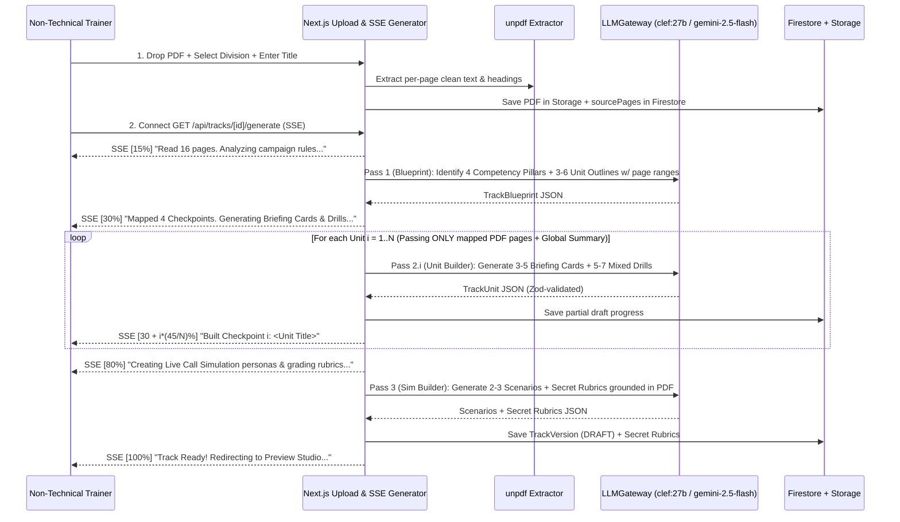

# 04 — AI Gateway & Automated PDF-to-Curriculum Pipeline Specification

---

## 1. Dual-Model Routing & Local-to-Cloud Provider Architecture

LogiCall Pulse uses a two-tier model routing strategy behind a single TypeScript `LLMGateway` interface:

* **`heavy` Tier (Reasoning, Structured JSON Curriculum Synthesis & Deterministic Rubric Grading):**
  * **Iteration 1 (Local macOS — Ollama):** `clef:27b-mxfp8` (default via `OLLAMA_HEAVY_MODEL`, configurable to any local Ollama model).
  * **Iteration 2 (Cloud API — Google Gemini):** `gemini-2.5-flash` (default via `GEMINI_HEAVY_MODEL`).
* **`fast` Tier (Sub-Second Streaming Counterparty Replies in *Live Call Sim*):**
  * **Iteration 1 (Local macOS — Ollama):** `clef-flash:9b-mxfp8` (default via `OLLAMA_FAST_MODEL`).
  * **Iteration 2 (Cloud API — Google Gemini):** `gemini-2.5-flash-lite` (default via `GEMINI_FAST_MODEL`).

---

## 2. Exact `LLMGateway` Code Specification (`src/lib/ai/`)

### 2.1 Provider-Agnostic Interface (`src/lib/ai/types.ts`)

```typescript
import { z } from 'zod';

export type ModelTier = 'heavy' | 'fast';

export interface ChatTurn {
  role: 'system' | 'user' | 'assistant';
  content: string;
}

export interface GenerateStructuredOptions<T extends z.ZodTypeAny> {
  tier: ModelTier;
  systemPrompt: string;
  userPrompt: string;
  schema: T;
  schemaName: string;
  temperature?: number; // Default 0.2 for deterministic grounded curriculum/grading
}

export interface StreamChatOptions {
  tier: ModelTier;
  messages: ChatTurn[];
  temperature?: number; // Default 0.6 for natural caller/patient conversation
  maxOutputTokens?: number;
  signal?: AbortSignal;
}

export interface LLMGateway {
  readonly providerName: 'ollama' | 'gemini';
  generateStructured<T extends z.ZodTypeAny>(
    opts: GenerateStructuredOptions<T>
  ): Promise<z.infer<T>>;
  streamChat(opts: StreamChatOptions): AsyncGenerator<string, void, unknown>;
  healthCheck(): Promise<{ ok: boolean; provider: string; models: string[]; error?: string }>;
}
```

### 2.2 Iteration 1 Adapter: `OllamaProvider` (`src/lib/ai/ollama-provider.ts`)

Connects directly to Connor's local Ollama daemon (`OLLAMA_BASE_URL=http://127.0.0.1:11434`) using Ollama's native `/api/chat` structured output (`format: jsonSchema`) and NDJSON streaming:

* **Structured JSON Reliability:**
  1. Converts the `zod` schema into draft-7 JSON Schema via `zodToJsonSchema(opts.schema, { target: 'jsonSchema7' })`.
  2. POSTs to `${OLLAMA_BASE_URL}/api/chat` with `stream: false`, `format: jsonSchema`, `keep_alive: "15m"`, and `options: { temperature: opts.temperature ?? 0.2, num_ctx: 16384 }`.
  3. Strips any accidental markdown code fences if a model emits them, parses JSON, and validates through `opts.schema.parse(...)`.
  4. **Automatic Self-Repair Retry (Max 2 Retries):** If Zod validation fails on a local model pass, automatically sends a single corrective follow-up containing the exact Zod validation error paths so local models never crash a trainer's PDF upload.
* **Streaming Roleplay Chat:**
  1. POSTs to `${OLLAMA_BASE_URL}/api/chat` with `stream: true` using `clef-flash:9b-mxfp8`.
  2. Reads `response.body` via `TextDecoderStream`, parses each NDJSON line, and yields `chunk.message.content` tokens immediately to the SSE stream.

### 2.3 Iteration 2 Adapter: `GeminiProvider` (`src/lib/ai/gemini-provider.ts`)

Uses the official `@google/genai` SDK (`new GoogleGenAI({ apiKey: process.env.GEMINI_API_KEY })`):

* **Structured JSON (`generateStructured`):**
  * Calls `ai.models.generateContent` with `model: tier === 'heavy' ? GEMINI_HEAVY_MODEL : GEMINI_FAST_MODEL`, `config: { systemInstruction, temperature: 0.2, responseMimeType: 'application/json', responseJsonSchema }`, followed by `opts.schema.parse(JSON.parse(res.text))`.
* **Streaming Roleplay (`streamChat`):**
  * Calls `ai.models.generateContentStream` on `gemini-2.5-flash-lite`, yielding `chunk.text` tokens directly into the SSE stream.

### 2.4 Environment Factory (`src/lib/ai/gateway.ts`)

```typescript
export function getLLMGateway(): LLMGateway {
  const provider = (process.env.AI_PROVIDER ?? 'ollama').toLowerCase();
  if (provider === 'gemini') return new GeminiProvider();
  return new OllamaProvider();
}
```

---

## 3. Staged PDF-to-Curriculum Pipeline ("Upload a PDF & Off to the Races")

Why **Staged Multi-Pass Generation** is critical (especially for local 27B models in Iteration 1):
Asking a local LLM to emit a 12,000-token JSON object containing 5 units, 20 cards, 30 drills, and 3 simulation rubrics in *one single call* causes slow time-to-feedback, context dilution, and occasional JSON truncation. Splitting synthesis into **4 focused, sequential passes** streamed over SSE gives the non-technical trainer live visual progress every few seconds and guarantees grounded, high-density training material.



### 3.1 PDF Extraction & Sanitization Rules (`src/lib/ai/pdf-extractor.ts`)
1. Enforce upload guardrails: `application/pdf`, max size **20 MB**, max **80 pages** per single Playbook (reject empty/encrypted/unreadable PDFs with a friendly plain-English message if extracted character count `< 150 chars`, advising the trainer if a PDF is an un-OCR'd image scan).
2. Normalize whitespace, preserve bullet lists and markdown-style table rows, and prefix every page cleanly as:
   `=== SOURCE PAGE 4 ===\n<page text>`
   so the LLM accurately cites `sourcePages: [4]` on every generated card, drill, and rubric rule!
3. **Token Window Guard:** If a PDF exceeds 25 pages, Pass 1 (`Blueprint`) receives structural headings + condensed per-page summaries, while Pass 2 (`Unit Builder`) receives the **exact verbatim text** of the pages assigned to that unit (`unitOutline.sourcePages`) plus a 500-word Global Campaign Summary—ensuring zero detail loss even on 60-page playbooks.

### 3.2 Prompt Rules & Grounding Invariants
1. **Strict Source Grounding:** Every prompt instructs the model: *"NEVER invent refund percentages, prices, phone numbers, CRM names, clinical dosages, or escalation SLAs not explicitly stated in the provided SOURCE PAGES. Use synthetic customer names and synthetic order numbers for scenario framing while enforcing exact policy rules from the PDF."*
2. **Mandatory Drill Variety:** Each Checkpoint (`Unit`) MUST include at least **4 distinct `kind`s** out of the 5 drill mechanics (`MULTIPLE_CHOICE`, `TRUE_FALSE_SPOT`, `SEQUENCE_ORDER`, `MATCH_PAIRS`, `FILL_BLANK_CHOICE`) so the training feels dynamic and Duolingo-like rather than a repetitive multiple-choice test.
3. **Cross-Track Competency Normalization:** Pass 1 maps each campaign pillar to both a campaign-specific label and one of **8 canonical LogiCall Skill Keys** (so the Strengths Heatmap works seamlessly across *all* campaigns in a division!):
   * `verification_crm` (*Identity, Intake & CRM Verification*)
   * `product_offer_terms` (*Product, Offer & Policy Accuracy*)
   * `retention_objection` (*Save-Offer Ladder & Objection Handling*)
   * `escalation_triage` (*Escalation Triage & Required Info*)
   * `compliance_boundaries` (*Regulatory, Payment & Clinical Boundaries*)
   * `empathy_communication` (*Empathy, De-escalation & Clarity*)
   * `closing_next_steps` (*Resolution, Closing & Disposition Logging*)
   * `workflow_execution` (*Call-Flow & Sequence Adherence*)

---

## 4. Dual-Agent *Live Call Sim* Engine (`src/lib/ai/prompts/sim-*.ts`)

### 4.1 Roleplay Counterparty Actor (`fast` Tier: `clef-flash:9b-mxfp8` / `gemini-2.5-flash-lite`)
* **System Prompt Construction:** Injects `personaName`, `personaBackstoryAndMood`, `hiddenFactsToRevealOnlyWhenAsked`, `conditionalBehaviors`, and `autoFailTriggers` from the server-only `SecretSimScenarioConfig`.
* **Behavioral Rules Enforced on the Actor:**
  1. Stay 100% in character as the caller, patient, or prospect. **Never** coach the agent or break character.
  2. Keep replies natural, concise (1–3 sentences, matching real phone/chat cadence), and in plain English.
  3. **Withhold `hiddenFactsToRevealOnlyWhenAsked`** (such as Zip code, Order ID, address, or underlying reason for canceling) until the trainee explicitly asks for them!
  4. When the trainee reaches a valid resolution (or commits a severe policy failure / hits `maxTurns`), append the exact sentinel token `<SIM_END>` at the end of the final counterparty message. The backend strips `<SIM_END>` from the streamed text and signals the UI to open the **Wrap-Up Disposition Picker**.

### 4.2 Deterministic Rubric Judge (`heavy` Tier: `clef:27b-mxfp8` / `gemini-2.5-flash`)
* Triggered once the trainee finishes the conversation and selects their **Call Disposition**.
* Evaluates the complete numbered transcript (`Turn 1..K`) + `selectedDisposition` against `SecretSimScenarioConfig.rubricCriteria` and `autoFailTriggers`.
* **Scoring Formula:**
  * Each criterion `i` with weight $w_i$ ($\sum w_i = 100$) receives a discrete score $s_i \in \{0, 50, 100\}$ backed by a verbatim quote from the agent's turns (`agentQuoteEvidence`).
  * Raw score: $S_{\text{raw}} = \sum_i \frac{w_i \cdot s_i}{100}$.
  * Disposition bonus/penalty: if `selectedDisposition !== expectedDisposition`, apply a `-10` point penalty (floored at `0`) and explain the correct disposition.
  * Auto-fail check: if an `autoFailTrigger` was clearly violated (e.g., offering a 25% discount step-down when the playbook mandates immediate medical escalation/refund), `passed` is forced to `false` and `overallScorePct = min(S_raw, 59)` with `autoFailedReason` populated clearly for coaching.
